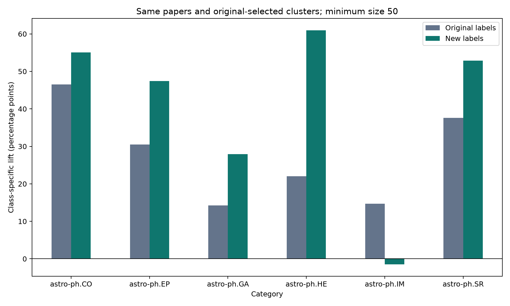

# Final author-label comparison

Saved method: `weighted_votes_existing_initial_keys`.

The original future_subcat uses surname + first-initial author keys (for example, smith_j), which can merge distinct people.
The saved new labels still use the original initial keys. They change voting to equal-author, publication-frequency-weighted votes with unresolved ties.
**Full-name author validation has not been run on these saved results.** The raw matching metadata is needed to rebuild full-name keys.

| Method | Resolved papers | Unresolved papers |
|---|---:|---:|
| original_saved | 102,990 | 3,072 |
| weighted_votes_existing_initial_keys | 102,054 | 4,008 |

55,989 commonly resolved papers changed label; 936 lost their label.

## Category lift on identical papers and clusters

Comparison uses 102,054 papers with both labels and saved GPU assignments.
For each category, select its best original-label cluster (minimum 50 papers), then compare both labels on that same cluster.
Lift = category concentration in the cluster minus that category's baseline rate across the identical comparison papers.

| Category | Cluster | Papers | Old concentration | New concentration | Old lift (pp) | New lift (pp) | Change (pp) |
|---|---:|---:|---:|---:|---:|---:|---:|
| astro-ph.CO | 17 | 600 | 77.5% | 79.7% | +46.5 | +55.1 | +8.6 |
| astro-ph.EP | 36 | 2,585 | 35.2% | 52.6% | +30.5 | +47.4 | +16.9 |
| astro-ph.GA | 15 | 435 | 27.4% | 52.6% | +14.3 | +27.9 | +13.6 |
| astro-ph.HE | 19 | 1,236 | 28.4% | 87.5% | +22.0 | +61.0 | +38.9 |
| astro-ph.IM | 16 | 691 | 26.9% | 1.6% | +14.7 | -1.5 | -16.2 |
| astro-ph.SR | 20 | 1,044 | 70.3% | 68.8% | +37.6 | +52.9 | +15.3 |

Lift increased for: astro-ph.CO, astro-ph.EP, astro-ph.GA, astro-ph.HE, astro-ph.SR.
Lift decreased for: astro-ph.IM.

`class_lift_comparison.csv` also reports the best cluster selected using new labels, separately from the paired comparison.

## Interpretation

These are descriptive, in-sample enrichment results against author-history proxies, not verified classification accuracy.
The text representation and K-means assignments are fixed; clustering was not rerun. Baseline rates are recalculated for each labeling method.
Higher lift against changed proxy labels is not proof that author identities or paper categories became more accurate.
For an identity-only comparison, rerun initial-key and full-name matching with identical voting, then compare the same paper IDs and cluster assignments.
Full-name matching can still merge identical names and split abbreviated/name variants. Statistical significance has not been tested.
