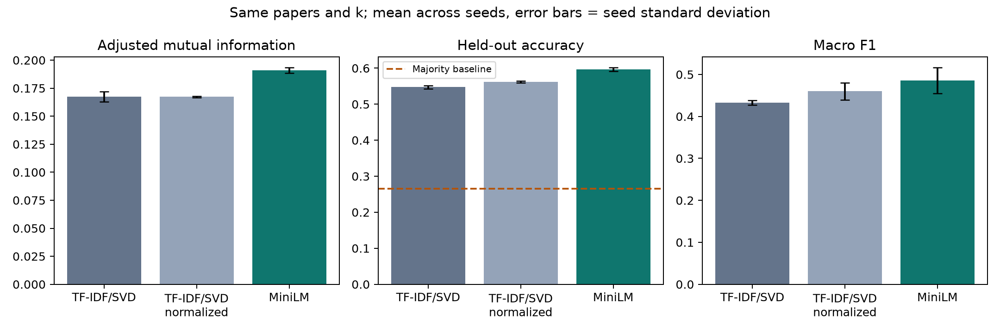

# Text representation comparison

15,000 papers; 12,000 training and 3,000 held-out papers. k=40.
Input: `astroph_pre_with_future_labels_new.parquet`. Majority-class test accuracy: 26.5%.

| Method | AMI | ARI | Accuracy | Macro F1 | Accuracy lift |
|---|---:|---:|---:|---:|---:|
| sentence_embeddings | 0.1909 | 0.0533 | 59.6% | 0.4856 | +33.1 pp |
| tfidf_svd | 0.1673 | 0.0378 | 54.7% | 0.4324 | +28.2 pp |
| tfidf_svd_normalized | 0.1673 | 0.0457 | 56.2% | 0.4601 | +29.7 pp |

MiniLM accuracy difference: +4.87 percentage points versus original TF-IDF/SVD, and +3.40 points versus normalized TF-IDF/SVD. No significance test has been performed.

Means across seeds; see comparison_seed_std.csv for variability. Seed variation is not a confidence interval.

TF-IDF vocabulary, SVD, K-means, cluster-to-label mapping, and best class-cluster selection use training papers only.
The normalized TF-IDF control helps distinguish the effect of vector normalization from the embedding method.
Class concentration and coverage in class_comparison.csv are measured on test papers for clusters selected on training papers.
6,057/15,000 abstracts exceed the embedding model limit of 256 tokens and were truncated.

Limitations: author-history labels are proxies; shared authors can connect train/test papers. This is a paper holdout, not author-disjoint validation.
Modern pretrained embeddings may contain post-2009 knowledge. This comparison is retrospective, not evidence of historical deployment or field emergence.
This subset comparison does not directly reproduce the full-dataset RAPIDS experiment.
